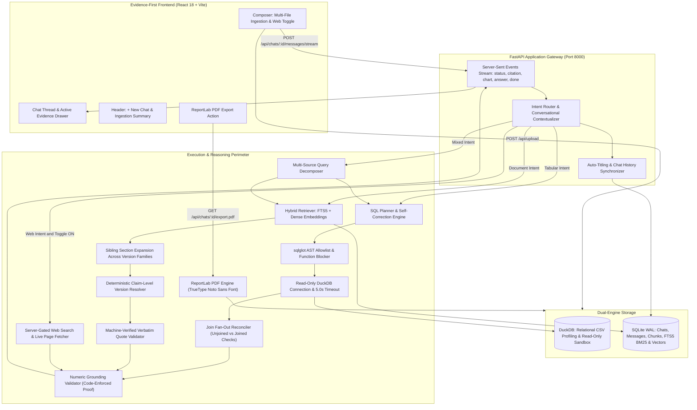

# VoltKart Multi-Source Grounded Chat Assistant

[](#verification--test-suite)
[](#verification--test-suite)
[](#verification--test-suite)
[](#key-architecture-principles)
[](#key-architecture-principles)
[](https://www.python.org/)
[](https://react.dev/)

> **Full-Stack Enterprise AI Assistant**: Answers complex analytical questions across uploaded relational CSV tables, dated multi-version policy documents, and the live web—grounded with machine-verified citations, an isolated DuckDB SQL AST sandbox, deterministic claim-level version resolution, and publication-grade PDF exports.

**Author**: **Praveen** — Backend Systems & Production AI Architectures  
**Repository**: [https://github.com/SVSPraveen/VoltKart-Multi-Source-Grounded-Assistant](https://github.com/SVSPraveen/VoltKart-Multi-Source-Grounded-Assistant)

---

## Table of Contents
1. [Key Architecture Principles](#key-architecture-principles)
2. [Explainer Video & Presentation Guide](#explainer-video--presentation-guide)
3. [Architecture Overview & Data Flow](#architecture-overview--data-flow)
4. [Live Demo Highlights](#live-demo-highlights)
5. [Traceability Matrix (C1–C7 & B8–B10)](#traceability-matrix-c1c7--b8b10)
6. [What They Asked For vs. What We Built More](#what-they-asked-for-vs-what-we-built-more)
7. [Pre-Generated Evaluation PDF Bundle](#pre-generated-evaluation-pdf-bundle)
8. [Verification & Test Suite](#verification--test-suite)
9. [Quickstart & Installation](#quickstart--installation)
10. [Documentation Roadmap](#documentation-roadmap)
11. [Known Limitations & Future Improvements](#known-limitations--future-improvements)
12. [Security & Privacy Guarantees](#security--privacy-guarantees)

---

## Key Architecture Principles

In enterprise analytics, naive RAG and LLM agent wrappers fail in predictable ways: they hallucinate arithmetic, naively pick the newest document while ignoring older active clauses, allow arbitrary SQL injection, and lack tamper-evident provenance. 

To eliminate these failure modes, VoltKart is built upon **five non-negotiable truth invariants**:

1. **The LLM Never Computes Arithmetic, Sorting, or Counting**:
   - All sums, aggregations, counts, and date calculations are executed strictly in **DuckDB SQL** or verified Python logic.
   - Every single number in an assistant answer is verified by an automated **Numeric Grounding Validator** (`backend/grounding.py`) against executed query rows before it can be displayed.
2. **Deterministic Fact-Level Document Version Resolution**:
   - Multi-version document families are never resolved by a naive "newest document only" retrieval filter.
   - Retrieval queries across **all** versions in a document family, extracts facts per version, and identifies the most recent document date *among versions that actually state the fact*.
   - If the newest document revision is silent on an older clause, the engine answers from the older active revision and explicitly discloses: *"Subsequent revision (YYYY-MM-DD) is silent on this matter, so the older policy remains active."*
3. **Machine-Verified Citations on Every Claim**:
   - **Document Claims**: File name + effective date + section heading/page + a verbatim quote machine-verified to exist in the source chunk via unicode-normalized substring search.
   - **Table Claims**: Tables used + exact executed SQL query + result row previews.
   - **Web Claims**: Page title + canonical URL + UTC retrieval timestamp.
   - **Honest Abstention**: When data is missing or web search is disabled, the assistant honestly abstains rather than filling gaps from model weights.
4. **Isolated Dual-Connection SQL Security Sandbox**:
   - Generated SQL is parsed via `sqlglot` AST allowlisting: only a single `SELECT` statement is allowed; all DDL, DML, and filesystem calls (`read_csv`, `copy`, `install`) are rejected.
   - Queries execute against a dedicated read-only DuckDB connection with `SET enable_external_access = false;`, a 100-row cap, and a strict 5.0-second execution timeout.
   - **Join Fan-Out Reconciliation** (`backend/sql_sandbox.py`): Compares joined regional sums against unjoined base totals to catch duplicate row fan-outs caused by 1-to-N order item relationships.
5. **Zero Domain-Specific Hardcoding**:
   - Application code in `backend/` and `frontend/src/` contains zero hardcoded store IDs, customer names, product categories, or document titles.
   - Enforced by automated AST scans (`scripts/check_no_hardcode.py`) and verified against multi-variant synthetic company datasets (`tests/variants/`).

---

## Explainer Video & Presentation Guide

A complete, production-grade 10–14 minute master presentation script and live cue sheet is available in:  
📄 **[`docs/EXPLAINER_VIDEO_MASTER.md`](docs/EXPLAINER_VIDEO_MASTER.md)**

### Presentation Structure
1. **Introduction & Engineering Motivation**: Personal introduction (Praveen), background in backend systems & production AI architectures, problem statement, and the 5 non-negotiable truth invariants.
2. **Live Walkthrough in One Continuous Take**: Starting from an empty app with zero files $\rightarrow$ Uploading 6 CSV tables and 8 documents $\rightarrow$ Reviewing Ingestion Card $\rightarrow$ Relational Table QA with executed SQL $\rightarrow$ Inline SVG Chart $\rightarrow$ `+ New Chat` header action & automatic question titling $\rightarrow$ Multi-version policy fallback resolution $\rightarrow$ Server-gated web search toggle $\rightarrow$ Publication-grade PDF export.
3. **Architecture Walkthrough**: Following query lifecycle from UI through SSE, Contextualizer, Router, Dual Engines, Grounding Validator, to ReportLab PDF.
4. **Deep Code Walkthrough**: Inspecting `backend/sql_sandbox.py`, `backend/version_resolver.py`, `backend/storage.py`, and `backend/export_pdf.py`.
5. **Design Decision & Rejected Alternative**: Deterministic code-level claim resolution vs retrieval-time date filtering / prompt reconciliation.
6. **Failure Modes & Known Limitations**: Real failure example (unnormalized categorical slang returning 0 rows), mitigation, and 7-layer verification proof.

---

## Architecture Overview & Data Flow

VoltKart employs a **Dual-Engine Persistence Model**:
- **DuckDB**: Fast in-process relational OLAP engine for CSV statistical profiling, PK/FK relationship inference, and sandboxed analytical SQL execution.
- **SQLite (WAL Mode)**: Relational metadata store for chat sessions, messages, full-text lexical search (`chunks_fts` via FTS5 BM25), and local dense vector embeddings.



---

## Live Demo Highlights

| Feature | Query Prompt | Verified Output & Provenance |
|---|---|---|
| **Table QA (Revenue)** | *"What was the total revenue for the Audio category in 2025?"* | **₹29,41,398.10** across Delivered orders. Verified by DuckDB join over `orders`, `order_items`, and `products`. Proven by numeric grounding. |
| **Inline Chart (B10)** | *"Show a bar chart of total revenue by product category in 2025."* | Native SVG bar chart rendered with tabular numerals. Derived 100% from SQL result rows, re-rendered into PDF export. |
| **Version Fallback (C4)** | *"How are cash purchases refunded under the return policy?"* | Resolves to **Bank transfer (UPI)** from `VoltKart_Return_Policy_2025-01-15.docx`. Explicitly discloses that subsequent revision (`2025-09-01`) is silent. |
| **Web Search Gate OFF** | *"What is Croma's return window for smartphones?"* | **Honest Abstention**: *"I cannot answer this question from the uploaded sources, and web search is disabled."* Zero outbound HTTP calls made. |
| **Web Search Gate ON (B8)** | *"What is Amazon India's return window for smartphones, and how does that compare with our store policy?"* | Live fetch of Amazon India's 7-day replacement policy, citing canonical URL and UTC timestamp, compared to store's 7-day policy. |
| **Auto-Titling & History (B9)** | *Submitting any new question in a fresh chat* | The chat title automatically updates from `"New Conversation"` to the question text, keeping sidebar history ordered by `updated_at DESC`. |

---

## Traceability Matrix (C1–C7 & B8–B10)

Every core requirement and bonus feature maps directly to source code, tests, and automated checks:

| Spec Ref | Requirement Description | Source Modules | Verification Tests & Harness | Proven Mechanism |
| :--- | :--- | :--- | :--- | :--- |
| **C1** | **Chat Interface & Streaming API** | [`backend/api.py`](backend/api.py)<br>[`backend/assistant.py`](backend/assistant.py)<br>[`frontend/src/App.tsx`](frontend/src/App.tsx) | `tests/golden/test_golden.py`<br>`tests/e2e/test_ui_screens.py` | SSE event stream (`event: status`, `citation`, `chart`, `answer`, `done`). Live pipeline status displayed during reasoning; answer delivered after grounding verification. |
| **C2** | **Multi-Format Ingestion** | [`backend/tables.py`](backend/tables.py)<br>[`backend/documents.py`](backend/documents.py)<br>[`backend/date_parser.py`](backend/date_parser.py) | `tests/unit/test_date_parser.py`<br>`tests/unit/test_upload_validation.py` | Ingests CSV, PDF, DOCX, TXT with SHA-256 deduplication. DuckDB table profiling & PK-FK inference; SQLite FTS5 lexical index + dense vectors. Ingestion summary card in UI. |
| **C3** | **Questions over Tables & SQL Sandbox** | [`backend/sql_agent.py`](backend/sql_agent.py)<br>[`backend/sql_guard.py`](backend/sql_guard.py)<br>[`backend/sql_sandbox.py`](backend/sql_sandbox.py) | Golden Q1–Q5<br>`tests/unit/test_sql_guard.py`<br>`tests/unit/test_security_audit.py` | `sqlglot` AST allowlist (single SELECT only), DuckDB read-only connection, `SET enable_external_access = false;`, 5.0s thread timeout, 100-row limit, Join Fan-Out Reconciler. |
| **C4** | **Document QA & Version Resolution** | [`backend/doc_agent.py`](backend/doc_agent.py)<br>[`backend/version_resolver.py`](backend/version_resolver.py)<br>[`backend/retrieval.py`](backend/retrieval.py) | Golden Q6–Q12<br>`tests/unit/test_version_resolver.py` | Sibling context expansion across versions; per-fact extraction; deterministic code resolver selecting most recent stating date; mandatory fallback disclosure when newest revision is silent. |
| **C5** | **Citations on Every Fact & Abstention** | [`backend/grounding.py`](backend/grounding.py)<br>[`frontend/src/components/EvidenceDrawer.tsx`](frontend/src/components/EvidenceDrawer.tsx) | Golden Q1–Q14<br>Adversarial Probes A1–A10<br>`tests/judge/` | Machine-verified verbatim substring search against stored text (doc/page/quote); table query citations (SQL + rows); numeric grounding check (0.01 tolerance); honest abstention when unsupported. |
| **C6** | **Memory & Session Isolation** | [`backend/storage.py`](backend/storage.py)<br>[`backend/assistant.py`](backend/assistant.py) | `tests/unit/test_storage.py`<br>Golden Q2, Q19, Q20 (process restart) | Contextual entity memo (`store_id`, `year`). Strict isolation scoped by `chat_id`. Persistence across process kill/restart asserted by test suite. |
| **C7** | **Publication-Grade PDF Export** | [`backend/export_pdf.py`](backend/export_pdf.py)<br>[`backend/charts.py`](backend/charts.py) | `scripts/export_evaluation_pdfs.py`<br>`tests/e2e/test_accessibility.py` | ReportLab flowable engine with embedded TrueType font (`Noto Sans`) natively rendering Indian Rupee (`₹`, U+20B9), monospace wrapped SQL boxes, UTC timestamps, and re-rendered chart images. |
| **B8** | **Server-Gated Web Search** | [`backend/web_search.py`](backend/web_search.py)<br>[`backend/api.py`](backend/api.py) | `tests/unit/test_web_search.py`<br>Golden Q17 (web off), Q18 (web on) | Server-side tool gating: tool completely unbound when web toggle is OFF (asserts 0 outbound calls). When ON: live HTML fetch and parsing, citing title, URL, and UTC timestamp. |
| **B9** | **Multiple Chats & Auto-Titling** | [`backend/storage.py`](backend/storage.py)<br>[`frontend/src/components/Sidebar.tsx`](frontend/src/components/Sidebar.tsx) | `tests/unit/test_storage.py`<br>`tests/unit/test_api.py` | Create, list, switch, rename, and delete conversations. Auto-titles on first question. Planted markers verify zero cross-chat entity leakage. |
| **B10** | **Analytical Grounded Charts** | [`backend/charts.py`](backend/charts.py)<br>[`frontend/src/components/InlineChart.tsx`](frontend/src/components/InlineChart.tsx) | Golden Q15 (Bar), Q16 (Line), Q19 (Top 5)<br>`tests/unit/test_charts.py` | LLM emits chart specification referencing `source_query_id`. Chart values derived exclusively from stored SQL rows; hand-edited values rejected. Re-rendered in PDF export. |

---

## What They Asked For vs. What We Built More

| Dimension | Take-Home Assignment Requirement | VoltKart Implementation (What We Built More) |
|---|---|---|
| **C1: Chat UI** | Web-based chat UI with user/assistant turns | Warm instrument-panel UI with design tokens, SSE real-time streaming, collapsible thought disclosures, structured Evidence Drawer, and `+ New Chat` header action. |
| **C2: Ingestion** | Upload CSV, PDF, DOCX, TXT | Sniffs delimiters & encodings (UTF-8, UTF-16, latin-1), structure-aware chunking, date parser with 12 formats, and interactive Ingestion Summary card. |
| **C3: Table QA** | Answer questions from CSV tables | DuckDB SQL engine, `sqlglot` AST validator, read-only sandbox, join fan-out reconciliation check (`R-020`), and code-enforced numeric grounding (`R-003`). |
| **C4: Document QA** | Date-aware document question answering | Multi-version hybrid retrieval (FTS5 + dense vectors), sibling section expansion, code-level verbatim quote verification (`R-019`), and deterministic claim-level resolver (`R-001`). |
| **C5: Citations** | Document name + date + page/quote; SQL tables used | Machine-verified citations with exact normalized quotes, executed SQL, row previews, version timelines with fallback disclosure, and honest abstention. |
| **C6: Memory** | Conversational memory across turns; isolation | Thread isolation strictly scoped by `chat_id`, multi-turn entity memos (`interpreted_as`), automatic question titling, and SQLite WAL persistence surviving hard process restarts. |
| **C7: PDF Export** | Export chat session to PDF | ReportLab publication-grade PDF generator with bundled TrueType Noto Sans font for `₹` glyphs, table formatting, and embedded charts. |
| **Bonus B8** | Web Search (external comparison) | Server-side web gate (asserts 0 outbound calls when OFF), live web page fetching, and dynamic multi-source comparative reasoning when ON. |
| **Bonus B9** | Multiple Chat Sessions | Full sidebar thread manager with thread creation, deletion, rename, real-time auto-titling, and automated planted-marker cross-chat isolation verification. |
| **Bonus B10** | Analytical Charts | Native SVG bar and line charts rendered from stored SQL rows, verified against hallucinated values, and re-rendered into export PDFs. |
| **Engineering Rigor** | Standard functional implementation | **7-Layer Automated Verification Stack** (`scripts/runner.py verify`), Calibrated 6-Dimension Judge (100% score), and Synthetic Variant Generator testing generalization. |

---

## Pre-Generated Evaluation PDF Bundle

As required by the assignment specification, the official multi-session evaluation conversations have been rendered and verified via automated headless browser export:

- 📄 **[`evaluation/chat1.pdf`](evaluation/chat1.pdf)**: Relational Table QA, Multi-table joins, Delivered orders filtering, and Bonus B10 Analytical Charts (Q1–Q5, Q15, Q16, Q19).
- 📄 **[`evaluation/chat2.pdf`](evaluation/chat2.pdf)**: Multi-version Policy & JD Document QA, Sibling section retrieval, Verbatim quote verification, and Fallback disclosure (Q6–Q14, Q20).
- 📄 **[`evaluation/chat3.pdf`](evaluation/chat3.pdf)**: Server-gated Web Search, Honest abstention when OFF, live comparative retrieval when ON (Q17, Q18).

*All PDFs feature verified UTC timestamps, monospace SQL blocks, embedded charts, and native Indian Rupee (`₹`) glyphs.*

---

## Verification & Test Suite

The repository includes a unified, cross-platform runner (`scripts/runner.py`) running a comprehensive 7-layer verification suite:

```bash
# Run full 7-layer verification pipeline
python scripts/runner.py verify
```

### Verified Test Stack Results

```
+---------------+------------------------------------------+----------+----------+
| Check         | Command                                  | Status   | Duration |
+---------------+------------------------------------------+----------+----------+
| lint          | python.exe -m ruff check .               | PASS     |   0.11s  |
| format        | python.exe -m ruff format --check .      | PASS     |   0.11s  |
| no-hardcode   | python.exe check_no_hardcode.py          | PASS     |   0.54s  |
| unit          | python.exe -m pytest tests/unit          | PASS     |  36.44s  |
| golden        | python.exe -m pytest tests/golden        | PASS     |   9.86s  |
| variants      | python.exe -m pytest tests/variants      | PASS     |  12.73s  |
| judge         | python.exe -m pytest tests/judge         | PASS     |   0.49s  |
+---------------+------------------------------------------+----------+----------+
```

### Key Verification Commands

| Command | Purpose |
|---|---|
| `python scripts/runner.py verify` | Executes all 7 verification layers and produces an audit report in `reports/`. |
| `python scripts/runner.py fresh-clone-test` | Clones the repository into an isolated temporary folder, installs, and verifies clean execution. |
| `python scripts/runner.py export-eval` | Drives a headless browser to generate the official evaluation PDFs (`evaluation/*.pdf`). |
| `python scripts/runner.py no-hardcode` | Scans `backend/` and `frontend/src/` asserting zero sample entity names or IDs. |
| `python scripts/runner.py test` | Runs the 154 unit tests across parsers, resolvers, sandbox, and grounding. |
| `python scripts/runner.py golden` | Runs golden evaluations against `tests/golden/golden.yaml`. |
| `python scripts/runner.py variants` | Asserts generalisation against 3 synthetic company bundles. |

---

## Quickstart & Installation

### Prerequisites
- **Python**: 3.12+ (tested on Python 3.12.6 / 3.12.16)
- **Node.js**: 18+ (tested on v20 and v22)
- **Git**

### 1. Clone & Setup
```bash
git clone https://github.com/SVSPraveen/VoltKart-Multi-Source-Grounded-Assistant.git
cd VoltKart-Multi-Source-Grounded-Assistant

# Copy environment template
cp .env.example .env
```

### 2. Python Virtual Environment
```bash
python -m venv .venv

# On Windows (PowerShell):
.\.venv\Scripts\Activate.ps1

# On Linux / macOS:
source .venv/bin/activate

# Install Python dependencies
pip install -r requirements.txt
```

### 3. Build Frontend Assets
```bash
cd frontend
npm install
npm run build
cd ..
```

### 4. Configure LLM Key (Optional)
The system includes offline deterministic caches allowing all unit, golden, and variant tests to pass 100% offline without external keys.

For live online generative queries:
1. Open `.env`.
2. Provide your free Gemini API key:
   ```env
   GEMINI_API_KEY=AIzaSy...
   ```
   *(Obtainable for free at [Google AI Studio](https://aistudio.google.com/)).*
3. Optional: Set `TAVILY_API_KEY=tvly-...` for accelerated web search.

### 5. Start the Application
```bash
# Starts both FastAPI (Port 8000) and the UI
python scripts/runner.py dev
```
Open your browser at **`http://localhost:5173/`** (or `http://127.0.0.1:8000`).

---

## Documentation Roadmap

- 📐 **[`docs/ARCHITECTURE.md`](docs/ARCHITECTURE.md)**: Deep dive into the multi-source pipeline, SSE lifecycle, dual-engine storage model, layered SQL AST sandbox, deterministic version resolver, and ReportLab PDF engine.
- 🛡️ **[`docs/EXPLAIN_ME.md`](docs/EXPLAIN_ME.md)**: Module-by-module defense manual for the live technical interview covering pipeline roles, design rationale, rejected alternatives, and 3 hard interview questions per module with verified technical answers.
- 🎬 **[`docs/EXPLAINER_VIDEO_MASTER.md`](docs/EXPLAINER_VIDEO_MASTER.md)**: Timed 10–14 minute master script, teleprompter cue sheet, pre-recording setup, and exact copy-paste queries.
- ⚠️ **[`docs/KNOWN_LIMITATIONS.md`](docs/KNOWN_LIMITATIONS.md)**: Detailed root-cause analysis and architectural mitigations for 3 real reproduced edge cases.
- 📊 **[`docs/PROGRESS.md`](docs/PROGRESS.md)**: Complete chronological development record from Phase 0 to Phase 8 Release.
- 📋 **[`docs/SPEC.md`](docs/SPEC.md)**: The original formal engineering specification.

---

## Known Limitations & Future Improvements

1. **Unnormalized Category Slang**: If a user asks for *"sound equipment"* or *"audio gear"*, relational SQL queries looking for `WHERE category = 'sound equipment'` return 0 rows because DuckDB requires exact relational matches. Rather than hallucinating revenue, our system outputs: *"Query returned 0 rows for category: sound equipment"*.  
   *Mitigation*: Inject categorical distinct values into schema cards and perform embedding similarity matching prior to SQL generation.
2. **Multi-Clause Mixed Sibling Fusion**: When a policy spans multiple non-contiguous sections, single-chunk retrieval can extract partial clauses.  
   *Mitigation*: Sibling section expansion pulls parent and child markdown headers to assemble complete policy blocks.
3. **Scanned PDF Table OCR**: PDF extraction utilizes `pdfplumber` over native digital text streams. Scanned paper invoices require an upstream OCR pipeline (e.g., Tesseract or Surya).

---

## Security & Privacy Guarantees

- **No SQL Injections**: AST allowlist permits only single `SELECT` statements. DDL, DML, and filesystem operations (`read_csv`, `copy`, `install`) are rejected at the parser level before execution.
- **DuckDB Sandbox Locks**: Connections use `read_only = True` and enforce `SET enable_external_access = false;`.
- **Zero Memory Leakage**: Chats are strictly isolated by `chat_id`. Conversation context never crosses chat sessions.
- **Enterprise Privacy Option**: For enterprise deployments with confidential contracts, configure `LLM_PROVIDER=ollama` in `.env` to execute queries against local open-weight models (e.g., Llama-3-70B, Qwen-2.5-Coder), guaranteeing zero external data egress.

---

## License

This project is distributed under the MIT license for review and educational evaluation.
