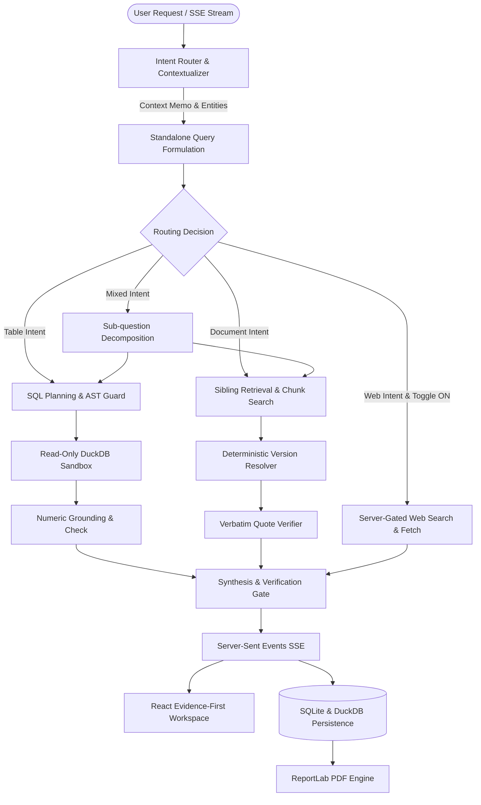

# VoltKart Architecture & Deep Dive

## 1. System Overview & Core Invariants

VoltKart Assistant is a grounded, multi-source analytical question answering system designed for enterprise data environments where truthfulness, auditability, and deterministic provenance are non-negotiable.

### Core Architectural Invariants
1. **The LLM Never Computes Arithmetic**: All sums, counts, ratios, date math, sorting, and aggregations are strictly executed in DuckDB SQL or Python code. Final answers are checked by a numeric grounding engine asserting that every presented number originates in verified query results.
2. **Deterministic Document Version Resolution**: Multi-version document families are never resolved by a naive "newest document only" filter. Retrieval operates across all versions, extracts candidate facts per version, and identifies the most recent document date *among versions that actually state the fact*. If the latest revision is silent on a clause, the engine answers from an older version and explicitly discloses the version provenance.
3. **Machine-Verified Citations**: Final answers are accompanied by machine-verified citations. Document claims carry exact filenames, effective dates, section headings or page numbers, and verbatim quotes verified against stored text. Table claims carry the exact list of tables, executed SQL, and result row previews.
4. **Isolated SQL Sandbox**: SQL queries generated by LLM agents are verified via AST allowlisting (`sqlglot`), restricted to a single SELECT statement, stripped of write or schema-modification capabilities, executed against an isolated read-only DuckDB connection with filesystem access disabled, and constrained by strict execution timeouts and row limits.
5. **No Sample-Specific Hardcoding**: Application logic in `backend/` and `frontend/src/` is strictly generic and decoupled from sample entity names, store IDs, or column values.

---

## 2. End-to-End Pipeline & Execution Flow

The assistant architecture coordinates retrieval, execution, verification, and presentation through a unidirectional pipeline:



### Pipeline Lifecycle & SSE Event Stream
When a user submits a query via `POST /api/chats/{chat_id}/messages`:
1. **Status Event 1**: `{"status": "Searching documents and database schemas..."}` is streamed to the UI.
2. **Contextualization**: Message history within `chat_id` is inspected. An entities memo (e.g., `store = S04`, `year = 2025`) is resolved to produce a standalone query and quiet `interpreted_as` metadata.
3. **Status Event 2**: `{"status": "Executing analytical SQL and retrieving source chunks..."}` is streamed as tools run concurrently.
4. **Verification & Grounding**: Query results and quotes undergo AST validation, row-value reconciliation, and verbatim substring search.
5. **Status Event 3**: `{"status": "Verifying citations and numeric grounding..."}` is emitted.
6. **Structured Citations**: Emitted via `event: citation` payloads.
7. **Chart Specs**: If an analytical visualization is appropriate (B10), `event: chart` delivers the chart specification tied directly to stored query rows.
8. **Final Answer**: Emitted via `event: answer` with full provenance, followed by `event: done`.

---

## 3. Dual-Engine Storage Model

The persistence layer separates analytical queries from relational conversation state:

```
┌──────────────────────────────────────────────┐
│                  DATA LAYER                  │
├──────────────────────┬───────────────────────┤
│    DuckDB Engine     │     SQLite Engine     │
│ (data/assistant.duckdb)│ (data/assistant.sqlite)│
├──────────────────────┼───────────────────────┤
│ • Ingested CSV Tables│ • Chat Sessions & Turns│
│ • Column Profiling   │ • Files & Versions    │
│ • Relationship Graph │ • Document Chunks     │
│ • Read-Only Sandbox  │ • FTS5 Full-Text Index│
│ • Analytical Queries │ • Local Dense Vectors │
└──────────────────────┴───────────────────────┘
```

### 1. DuckDB: Analytical Engine
- **Role**: High-performance columnar storage for structured tabular data (`orders`, `order_items`, `customers`, `products`, `stores`, `returns`).
- **Profiling**: Automatically inspects null fractions, distinct counts, min/max bounds, and numeric distributions upon upload.
- **Relationship Inference**: Automatically detects primary key - foreign key relationships across tables using naming conventions and value overlap ratios, providing rich context to the SQL planner.
- **Data Dictionary Ingestion**: Automatically pairs markdown data dictionaries with schema profiles so the SQL generator knows business rules (e.g., delivered-only revenue definition).

### 2. SQLite: Relational & Vector Index
- **Role**: Manages application state, conversation history, and document indexing.
- **FTS5 Full-Text Search**: Inverted index (`chunks_fts`) over document sections, supporting BM25 token ranking, phrase matching, and prefix searches.
- **Dense Embeddings**: Local FastEmbed vectors (`BAAI/bge-small-en-v1.5`) stored as binary BLOBs with cosine similarity ranking for semantic semantic search.
- **Hybrid Retrieval**: Combines Reciprocal Rank Fusion (RRF) between lexical FTS5 matches and semantic vector distances.

---

## 4. Multi-Layer SQL Security Sandbox

Executing LLM-generated SQL against enterprise databases presents severe injection and data-corruption risks. VoltKart enforces a 5-layer security perimeter:

1. **AST Allowlisting (`backend/sql_guard.py`)**:
   - Parses the query using `sqlglot` under the DuckDB dialect.
   - Enforces that the root AST node is strictly an `exp.Select` (or Union of Selects).
   - Rejects statements containing `DROP`, `DELETE`, `INSERT`, `UPDATE`, `ALTER`, `COPY`, `PRAGMA`, `ATTACH`, `DETACH`, or multiple semicoloned statements.
2. **Engine Introspection Blocking**:
   - Rejects any functions matching DuckDB, SQLite, or PostgreSQL introspection patterns (`duckdb_*`, `sqlite_*`, `pg_*`, `read_csv`, `read_parquet`, `httpfs`).
3. **Read-Only Dual Connection (`backend/sql_sandbox.py`)**:
   - The application maintains a write connection exclusively during ingestion.
   - All analytical and agent queries execute on a separate connection initialized with `read_only = True`.
   - Execution lock: `SET enable_external_access = false;` is asserted, blocking local disk access, subprocess invocation, or external network calls.
4. **Execution Timeout**:
   - Queries execute within a thread-pool future with a strict 5.0-second timeout to prevent denial-of-service via Cartesian join explosions.
5. **Enforced Row Cap**:
   - Results are capped at 50 rows via `cursor.fetchmany(row_cap)` to prevent memory exhaustion and large payload serialization.

---

## 5. Deterministic Document Version Resolver

Standard RAG architectures fail when encountering dated policy revisions: filtering to the newest document causes silent omissions if the latest revision omits older clauses, while unfiltered retrieval causes contradictions.

```
Query: "How soon must a customer report a product damaged on delivery?"

Step 1: Retrieve matching chunks across ALL document versions.
        ├── Version 2024-04-01 (v1.0): "Report within 48 hours with photographs..."
        ├── Version 2025-01-15 (v2.0): [Silent on damaged delivery reporting]
        └── Version 2025-09-01 (v3.0): [Silent on damaged delivery reporting]

Step 2: Sibling Expansion
        Expand context to include surrounding sections in the same family.

Step 3: Fact Extraction per Version
        Extract candidate fact from each version independently.
        - 2024-04-01 -> "within 48 hours of delivery"
        - 2025-01-15 -> None
        - 2025-09-01 -> None

Step 4: Deterministic Resolution
        Find most recent version stating the fact: 2024-04-01.
        Check newest version in family: 2025-09-01.
        Is newest version silent? YES -> FALLBACK DISCLOSURE TRIGGERED.

Step 5: Verbatim Quote Verification
        Assert that the cited quote exists character-for-character in the stored text.

Result: Answer from 2024-04-01 with mandatory version disclosure.
```

---

## 6. ReportLab Publication-Grade PDF Engine

Conversations, verified evidence, analytical SQL, and charts export as auditable PDF documents (`GET /api/chats/{chat_id}/export.pdf`):

- **Typography & Font Embedding**: Registers bundled TrueType Unicode fonts (`NotoSans-Regular.ttf` and `NotoSans-Bold.ttf`) to natively render the Indian Rupee symbol (`₹`, U+20B9) without tofu blocks or character corruption.
- **Monospace SQL & Row Tables**: SQL statements wrap cleanly in syntax-highlighted code blocks with execution row counts.
- **Re-rendered Analytical Charts**: Chart specifications stored during chat generation are re-rendered server-side via `matplotlib` into high-resolution PNG streams and embedded directly into the document flow.
- **Message Metadata**: Every turn documents its exact UTC timestamp, role, quiet interpreted query line, and server-side web search toggle state (`[Web: ON]` vs `[Web: OFF]`).
