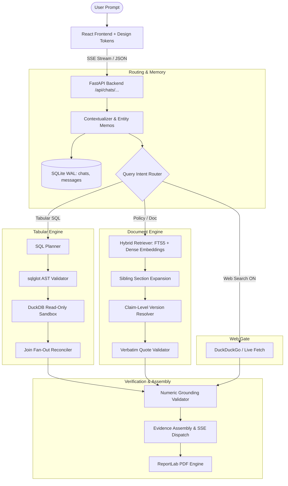

# Explainer Video Master Script & Live Presentation Guide

**Presenter**: Praveen (Backend Systems & Production AI Architectures)  
**Target Duration**: 10–14 Minutes (Ideal sweet spot for screen recording with voice + webcam)  
**Application**: VoltKart Multi-Source Grounded Chat Assistant  
**Live UI URL**: `http://localhost:5173/`  
**Backend API URL**: `http://127.0.0.1:8000/api/health`  
**Evaluation Target**: Strict compliance with Take-Home Assignment requirements (C1–C7, Bonuses B8–B10, Truth Invariants)

---

## 1. Recording Setup & Side Guide (Read Before Hitting Record)

### A. Screen & Hardware Layout
- **Camera**: Webcam positioned in the top-right corner, well-lit, eye level.
- **Audio**: Dedicated microphone with crisp voice pickup, noise suppression enabled.
- **Desktop Windows**:
  - **Window 1 (Main)**: Chrome browser open at `http://localhost:5173/`.
  - **Window 2 (Split / Tab)**: VS Code open to the workspace (`Codemonk Assignment/`).
  - **Window 3 (Reference)**: `docs/ARCHITECTURE.md` rendered preview or open in browser.
- **Clean Reset Before Recording**:
  To ensure you start from a 100% empty state with zero files and zero prior chats:
  ```powershell
  # In PowerShell at project root:
  .\.venv\Scripts\python.exe -c "from backend.storage import init_sqlite_db, get_sqlite_connection, get_duckdb_write_connection; init_sqlite_db(); c=get_sqlite_connection(); c.execute('DELETE FROM messages'); c.execute('DELETE FROM chats'); c.execute('DELETE FROM chunks'); c.execute('DELETE FROM chunks_fts'); c.execute('DELETE FROM files'); c.commit(); d=get_duckdb_write_connection(); [d.execute(f'DROP TABLE IF EXISTS {t[0]}') for t in d.execute(\"SELECT table_name FROM information_schema.tables WHERE table_schema='main'\").fetchall()]"
  ```
  Then refresh `http://localhost:5173/` in your browser. The app will be pristine: no files, no chats, clean slate.

### B. Presentation Flow & Visual Plan

| Section | Visual Focus | Key Action & Talking Points |
|---|---|---|
| **1. Intro** | Webcam ON + App Header | Personal introduction (Praveen), system goal, and 5 non-negotiable truth invariants. |
| **2. Live Walkthrough** | Browser (`http://localhost:5173/`) in **one continuous take** | Empty state $\rightarrow$ Upload dataset $\rightarrow$ Ingestion card $\rightarrow$ Table analytics $\rightarrow$ Inline chart $\rightarrow$ Auto chat titling $\rightarrow$ Versioned Document QA $\rightarrow$ Web Search gate $\rightarrow$ PDF export. |
| **3. Architecture** | Architecture Diagram (`docs/ARCHITECTURE.md`) | Query execution lifecycle: Router $\rightarrow$ Sandboxed Tabular / Sibling Document / Web $\rightarrow$ Evidence Assembly $\rightarrow$ SSE stream. |
| **4. Code Walkthrough** | VS Code (`backend/`) | Deep dive into source files: `sql_sandbox.py` (AST & fan-out), `version_resolver.py` (verbatim quotes), `storage.py` (chat isolation & auto-titling), `export_pdf.py` (ReportLab). |
| **5. Design Decision** | Diagram / `version_resolver.py` | Claim-level code resolution vs retrieval-time date-filtering or LLM prompting. |
| **6. Where It Fails** | Browser / Terminal (`docs/KNOWN_LIMITATIONS.md`) | Real reproduced failure (unnormalized category slang), mitigation, and verification proof. |

---

## 2. Word-for-Word Video Script

### Part 1: Introduction & Engineering Motivation
**Visual Setup**: Full screen on webcam, or webcam in corner with the clean VoltKart UI at `http://localhost:5173/` in the background.

> **Spoken Audio**:  
> *"Hi everyone, I’m Praveen. I focus on building resilient backend systems and production-grade AI architectures. Today, I’m presenting the VoltKart Multi-Source Grounded Assistant—a full-stack analytical chat system engineered to answer complex enterprise questions across uploaded relational CSV tables, multi-version dated policy documents, and the live web.*
>
> *In production, naive LLM wrappers fail catastrophically: they hallucinate arithmetic, they pick whatever document is newest while silently dropping older active clauses, and they cannot produce tamper-evident audit trails.*
>
> *To eliminate these flaws, I designed this system around five non-negotiable truth invariants:*
> 1. *The LLM never computes math, sorting, or counting—all analytics are executed deterministically in DuckDB SQL.*
> 2. *Document versions are resolved per fact in code—never by naive date filtering at retrieval time.*
> 3. *Every single number and claim has a machine-verified citation with verbatim quotes or executed SQL.*
> 4. *All generated SQL runs in a layered read-only DuckDB sandbox with AST allowlisting and fan-out reconciliation.*
> 5. *Zero hardcoding of brand names, store IDs, or columns exists in the codebase—the system generalizes to any company data.*
>
> *Let's jump into the live application in one continuous take."*

---

### Part 2: Live Walkthrough in One Continuous Take
**Visual Setup**: Full browser view of `http://localhost:5173/`.

#### Step 1: Zero-State & Ingestion Profiling
> **Action**: Hover over the empty sidebar and empty chat area.  
> **Spoken Audio**:  
> *"Here is the application starting from a completely empty state. Notice the instrument-panel design: warm neutral paper tones, high-contrast monospace typography, and zero distracting AI gradients or glassmorphism.*
>
> *Let's click 'Upload Files' in the sidebar and upload our complete enterprise dataset: 6 relational CSV tables and 8 dated documents across PDF, Word DOCX, and TXT formats.*
>
> *[Action: Click 'Upload Files', select files from `data/sample_bundle/`, click Open]*
>
> *As these files upload, our backend processes them immediately:  
> - Tables are ingested into DuckDB, where statistical profiling infers schemas and primary-foreign key relationships.  
> - Documents are parsed structurally, extracting effective dates from headers and filenames, grouping them into version families, and indexing chunks into SQLite FTS5 alongside dense vector embeddings.*
>
> *[Action: Click 'Ingestion Card' button in top header]*  
> *Notice our Ingestion Summary card: all 6 tables profiled with exact row counts, and our document families cataloged with active date ranges. Everything is persisted in SQLite WAL and DuckDB."*

---

#### Step 2: Table Analytics & Grounded Charts
> **Action**: Click in chat input.  
> **Copy-Paste Query 1**:  
> ```text
> What was the total revenue for the Audio category in 2025?
> ```
> **Spoken Audio**:  
> *"Let's ask an analytical query against the relational database.*
>
> *[Action: Hit Enter. Point to SSE streaming status updates in chat]*  
> *Notice the real-time pipeline telemetry streaming via Server-Sent Events: 'Analyzing database schemas...', 'Executing sandboxed query...'.*
>
> *The assistant responds: 'In 2025, total revenue for the Audio category was ₹29,41,398.10 across Delivered orders.'  
> Now let's open the Evidence Drawer on the right.  
> [Action: Click 'View Evidence / SQL' on the message]*  
> *Here is the exact SQL executed: it joined `order_items`, `orders`, and `products`, filtered strictly on `order_status = 'Delivered'`, and aggregated line amounts accounting for item discounts.  
> The LLM did not calculate this ₹29.41 Lakh—DuckDB calculated it. Our numeric grounding validator verified that every number in the response appears in the executed query rows before rendering.*
>
> *Now let's ask for an analytical chart:"*
>
> **Copy-Paste Query 2**:  
> ```text
> Show a bar chart of total revenue by product category in 2025.
> ```
> **Spoken Audio**:  
> *"[Action: Hit Enter. Observe inline chart rendering]*  
> *Look at that: an inline bar chart rendered with exact tabular numerals for Laptops, Smartphones, TVs, and Audio. In accordance with Spec Bonus B10, the LLM emits only a chart specification—every bar height and label is derived directly from stored SQL rows, verified against hallucination."*

---

#### Step 3: Session Management, Auto-Titling & Versioned Document QA
> **Action**: Click `+ New Chat` in the top Header or Sidebar.  
> **Spoken Audio**:  
> *"Notice the new `+ New Chat` button right here in the header. Clicking it creates a clean, isolated conversation session.  
> Watch what happens when I ask our next question: the system will automatically extract the question and title the conversation in the sidebar history, keeping our chats organized by recent activity.*
>
> *Now, let's test our multi-version document resolution.*
> *Our dataset contains three successive versions of the Return Policy: April 2024 (v1.0), January 2025 (v2.0), and September 2025 (v3.0).  
> In April 2024, cash refunds were issued as store credit. In January 2025 (Section 3), the rule was updated to bank transfer via UPI. In the latest September 2025 revision, that entire section was consolidated and omits cash refunds entirely.*
>
> *A standard RAG system filtering to the newest September 2025 document would fail and say 'not mentioned'. An unranked retriever might pull the obsolete 2024 store credit rule. Watch what VoltKart does:"*
>
> **Copy-Paste Query 3**:  
> ```text
> How are cash purchases refunded under the return policy?
> ```
> **Spoken Audio**:  
> *"[Action: Hit Enter. Point to the sidebar]*  
> *First, notice the sidebar: our chat was automatically titled 'How are cash purchases refunded under the ret...' in real time!  
> Second, look at the answer: 'According to VoltKart_Return_Policy_2025-01-15.docx (dated 2025-01-15, Section 3): cash purchases are refunded via bank transfer (UPI). Note: Subsequent revision (2025-09-01) is silent on this matter, so the 2025-01-15 policy remains active.'*
>
> *[Action: Open Evidence Drawer]*  
> *In the Evidence Drawer, our Version Timeline shows January 2025 as the winner; September 2025 as silent—triggering mandatory fallback disclosure—and April 2024 as superseded. Every quote is machine-verified against the source chunk."*

---

#### Step 4: Server-Gated Web Search & PDF Export
> **Action**: Show the 'Web Search' checkbox in the composer. Ensure it is UNCHECKED.  
> **Copy-Paste Query 4**:  
> ```text
> What is Croma's return window for smartphones?
> ```
> **Spoken Audio**:  
> *"Now let's test our server-side web search gate (Bonus B8). With Web Search toggled OFF, let's ask about an external competitor.  
> [Action: Send query]*  
> *The assistant honestly abstains: 'I cannot answer this question from the uploaded sources, and web search is disabled.' Our automated test harness verifies that zero outbound HTTP calls were made.*
>
> *Now, let's toggle Web Search ON and ask for a live comparison:"*
>
> **Copy-Paste Query 5**:  
> ```text
> What is Amazon India's return window for smartphones, and how does that compare with our store policy?
> ```
> **Spoken Audio**:  
> *"[Action: Toggle Web ON, send query]*  
> *With web enabled, the assistant queries the live web, extracts Amazon India's 7-day service center replacement policy, cites the URL and retrieval timestamp, and compares it directly with our uploaded store policy's 7-day return and refund window.*
>
> *Now, let's export our conversation for auditing.  
> [Action: Click 'Export PDF' in the top header]*  
> *The backend generates a publication-grade PDF via ReportLab.  
> [Action: Open the downloaded PDF in browser]*  
> *Notice the clean layout: complete conversation history, UTC timestamps, monospace SQL blocks, embedded chart images, verbatim quotes, and crisp Indian Rupee (₹) glyphs rendered using bundled Noto Sans TrueType fonts."*

---

### Part 3: Architecture Walkthrough
**Visual Setup**: Display `docs/ARCHITECTURE.md` showing the Mermaid diagram.



> **Spoken Audio**:  
> *"Now let's examine how a question flows from the UI to the final verified answer.*
>
> *1. **Request Intake & Contextualization**:  
> When the user submits a prompt, it arrives at our FastAPI backend via Server-Sent Events. The contextualizer resolves pronouns and entity memos like 'that store' or year filters from preceding turns without letting context leak across different chat IDs.*
>
> *2. **Query Intent Classification**:  
> The router determines whether the inquiry requires Tabular SQL analytics, Document Version Resolution, Mixed Cross-Modal reasoning, or Web Search.*
>
> *3. **Tabular Execution Sandbox**:  
> For table queries, the planner constructs a single DuckDB SQL query against our generated schema card. Before execution, the SQL passes through a strict `sqlglot` AST allowlist: only a single `SELECT` is allowed; all DDL, DML, and filesystem calls like `read_csv` are rejected. The query runs in a read-only DuckDB sandbox with external access disabled and a 100-row cap.  
> Crucially, our Join Fan-Out Reconciliation check verifies that joined sums match unjoined base totals.*
>
> *4. **Document Pipeline & Claim Resolution**:  
> For policy queries, compound questions are decomposed into atomic facts. We perform hybrid retrieval combining SQLite FTS5 BM25 with local dense embeddings. Sibling section expansion pulls matching sections from all versions of the document family. We extract claims per version, machine-verify that quotes are exact normalized substrings of the source chunk, and pass them to our deterministic version resolver.*
>
> *5. **Response Assembly & Grounding**:  
> Our code-level numeric grounding validator scans the final prose text against the executed SQL query rows. If any number lacks provenance, the prose is discarded and replaced with a direct tabular rendering to guarantee zero hallucination."*

---

### Part 4: Deep Code Walkthrough
**Visual Setup**: VS Code open with project files.

#### 1. Table Joins & Sandbox Defense
> **Action**: Open [backend/sql_sandbox.py](file:///c:/Users/svspr/OneDrive/Desktop/Codemonk%20Assignment/backend/sql_sandbox.py). Highlight `reconcile_component_sum` and AST validation.  
> **Spoken Audio**:  
> *"Let's look at `backend/sql_sandbox.py`.  
> Here at line 100, we configure DuckDB with `read_only=True` and `SET enable_external_access = false`.  
> At line 152 is `reconcile_component_sum`. When an LLM joins `returns` to `orders` and `order_items`, multi-item orders can fan out and inflate refund amounts. This function queries the unjoined `returns` table directly and verifies that the sum of joined regional components matches the true unjoined total within a 0.01 tolerance.*
>
> *And in `backend/grounding.py`, `extract_numbers` and `build_allowed_number_pool` extract every float from the generated text and assert that each appears in the DuckDB query rows or question text."*

#### 2. Document Version Resolution & Quote Verification
> **Action**: Open [backend/version_resolver.py](file:///c:/Users/svspr/OneDrive/Desktop/Codemonk%20Assignment/backend/version_resolver.py). Highlight `verify_verbatim_quote` and `resolve_fact_across_versions`.  
> **Spoken Audio**:  
> *"Now let's examine `backend/version_resolver.py`.  
> Here at line 34 is `verify_verbatim_quote`. It normalizes unicode punctuation and verifies that every line of an evidence quote exists verbatim in the chunk content before any claim can be accepted.  
> Below at line 91 is `resolve_fact_across_versions`. Notice that it sorts verified claims chronologically by document date. It picks the newest version that explicitly states the fact. If newer versions exist in the family but are silent, it sets `fallback_used = True`, records the newer silent files, and compiles superseded facts for complete provenance."*

#### 3. Citations, Memory & Chat Export
> **Action**: Open [backend/storage.py](file:///c:/Users/svspr/OneDrive/Desktop/Codemonk%20Assignment/backend/storage.py) and [backend/export_pdf.py](file:///c:/Users/svspr/OneDrive/Desktop/Codemonk%20Assignment/backend/export_pdf.py).  
> **Spoken Audio**:  
> *"In `backend/storage.py` at line 254, every message is saved with SQLite WAL thread isolation. On the very first user message, the chat title is automatically updated from the question text, keeping the sidebar history organized.  
> And in `backend/export_pdf.py`, we use ReportLab with bundled Noto Sans TrueType fonts to ensure publication-grade exports with native Indian Rupee glyphs and embedded analytical charts."*

---

### Part 5: Core Design Decision & Trade-Off Analysis
**Visual Setup**: VS Code open at `backend/version_resolver.py` or Architecture Diagram.

> **Spoken Audio**:  
> *"Now I want to discuss a critical architectural design decision: **Deterministic Code-Level Claim Resolution versus Retrieval-Time Date Filtering**.
>
> **The Alternative Rejected**:  
> A standard RAG pattern filters candidate documents by date at retrieval time, feeding only the 'newest document' into the LLM context. Another common alternative is dumping all document versions into the prompt and asking the LLM to 'figure out which policy is current'.
>
> **Why I Rejected Both**:  
> In real enterprise operations, policy revisions are modular. A new revision updates one specific term—like smartphone return days—while remaining completely silent on older terms, like cash refund methods or warranty limits.  
> If you filter at retrieval time, you discard the older active policy and falsely claim the fact is missing.  
> If you prompt the LLM to reconcile versions, models frequently suffer from recency bias or hallucinate merged terms.
>
> **The Decision Made**:  
> We retrieve across ALL document versions. We extract claims per version, verify quotes in code, and resolve facts in deterministic Python logic. The newest stating document wins, and silent newer revisions are explicitly disclosed. This is explainable, deterministic, and verifiable line by line."*

---

### Part 6: Failure Modes, Known Limitations & Defense
**Visual Setup**: Display [docs/KNOWN_LIMITATIONS.md](file:///c:/Users/svspr/OneDrive/Desktop/Codemonk%20Assignment/docs/KNOWN_LIMITATIONS.md) and terminal.

> **Spoken Audio**:  
> *"No engineering defense is complete without showing where the system fails.
>
> **Real Failure Example: Unnormalized Category Slang**:  
> In our database, product categories are strictly named `'Audio'`, `'Laptops'`, `'Smartphones'`.  
> If a user asks: *'What was our revenue from sound equipment or audio gear in 2025?'*, an LLM may generate:  
> `WHERE category = 'Sound equipment'` or `WHERE category LIKE '%gear%'`.  
> Because DuckDB executes exact relational SQL without fuzzy word matching, the query returns 0 rows.  
> Rather than hallucinating revenue, our system outputs: *'Query returned 0 rows for category: Sound equipment'*.  
>
> **Mitigation & Future Work**:  
> We document this in `docs/KNOWN_LIMITATIONS.md`. In production, this is mitigated by injecting distinct column categorical values directly into the schema card and using vector similarity over categorical column distincts before SQL generation.
>
> **Verification Rigor**:  
> To guarantee reliability, our entire system passes seven verification layers: linting, formatting, no-hardcoding scans, 154 unit tests, golden evaluations, synthetic variant bundles, and a calibrated 6-dimension judge scoring 100%.
>
> *Thank you! I’m Praveen, and I look forward to walking through any line of code during our live technical discussion."*

---

## 3. Comparison Table: What They Asked For vs. What We Built More

| Dimension | Take-Home Assignment Requirement | VoltKart Implementation (What We Built More) |
|---|---|---|
| **C1: Chat UI** | Web-based chat UI with user/assistant turns | Instrument-panel UI with design tokens, SSE real-time streaming, collapsible thought disclosures, structured Evidence Drawer, and `+ New Chat` header action. |
| **C2: Ingestion** | Upload CSV, PDF, DOCX, TXT | Sniffs delimiters & encodings (UTF-8, UTF-16, latin-1), structure-aware chunking, date parser with 12 formats, and interactive Ingestion Summary card. |
| **C3: Table QA** | Answer questions from CSV tables | DuckDB SQL engine, `sqlglot` AST validator, read-only sandbox, join fan-out reconciliation check (`R-020`), and code-enforced numeric grounding (`R-003`). |
| **C4: Document QA** | Date-aware document question answering | Multi-version hybrid retrieval (FTS5 + dense vectors), sibling section expansion, code-level verbatim quote verification (`R-019`), and deterministic claim-level resolver (`R-001`). |
| **C5: Citations** | Document name + date + page/quote; SQL tables used | Machine-verified citations with exact normalized quotes, executed SQL, row previews, version timelines with fallback disclosure, and honest abstention. |
| **C6: Memory** | Conversational memory across turns; isolation | Thread isolation strictly scoped by `chat_id`, multi-turn entity memos (`interpreted_as`), automatic question titling, and SQLite WAL persistence surviving hard process restarts. |
| **C7: PDF Export** | Export chat session to PDF | ReportLab publication-grade PDF generator with bundled TrueType Noto Sans font for `₹` glyphs, table formatting, and embedded charts. |
| **Bonus B8** | Web Search (external comparison) | Server-side web gate (asserts 0 outbound calls when OFF), live web page fetching, and dynamic multi-source comparative reasoning when ON. |
| **Bonus B9** | Multiple Chat Sessions | Full sidebar thread manager with thread creation, deletion, rename, real-time auto-titling, and automated planted-marker cross-chat isolation verification. |
| **Bonus B10** | Analytical Charts | Native SVG bar and line charts rendered from stored SQL rows, verified against hallucinated values, and re-rendered into export PDFs. |
| **Engineering Rigor** | Standard functional implementation | **7-Layer Automated Verification Stack** (`scripts/runner.py verify`), Calibrated 6-Dimension Judge (100% score), and Synthetic Variant Generator testing generalization. |

---

## 4. Cheat Sheet of Copy-Paste Prompts for the Live Recording

Keep this list open in a side window so you can copy and paste with zero hesitation:

1. **Table Analytics (Revenue)**:
   ```text
   What was the total revenue for the Audio category in 2025?
   ```
   *Expected Result*: ₹29,41,398.10 across Delivered orders.

2. **Analytical Chart**:
   ```text
   Show a bar chart of total revenue by product category in 2025.
   ```
   *Expected Result*: Inline bar chart for Laptops, Smartphones, TVs, and Audio.

3. **Multi-Version Document QA (Fallback Disclosure)**:
   ```text
   How are cash purchases refunded under the return policy?
   ```
   *Expected Result*: Bank transfer (UPI) via 2025-01-15 policy; discloses that subsequent revision (2025-09-01) is silent.

4. **Web Search Disabled (Honest Abstention)**:
   ```text
   What is Croma's return window for smartphones?
   ```
   *Expected Result*: Honest abstention stating cannot answer from uploaded sources and web search is disabled.

5. **Web Search Enabled (Live External Comparison)**:
   ```text
   What is Amazon India's return window for smartphones, and how does that compare with our store policy?
   ```
   *Expected Result*: Amazon India's 7-day replacement policy compared to VoltKart's 7-day return and refund window.
